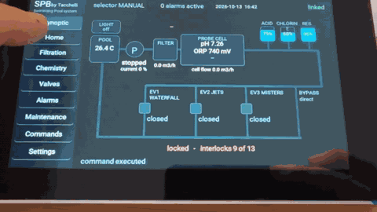
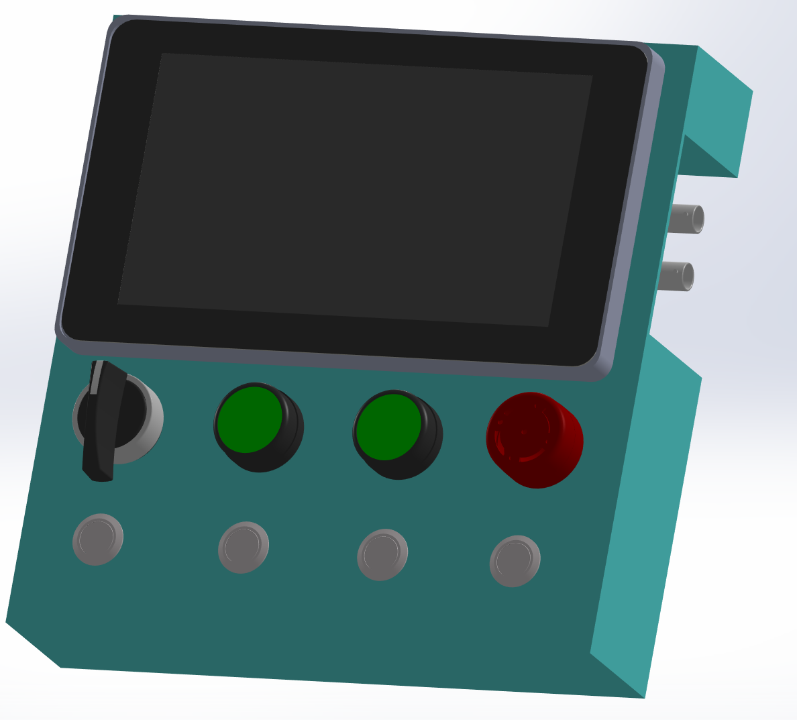
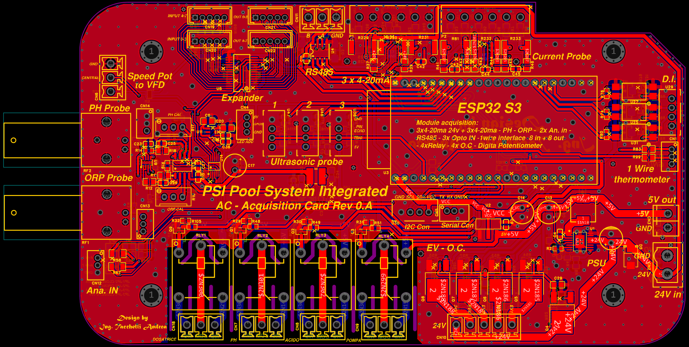
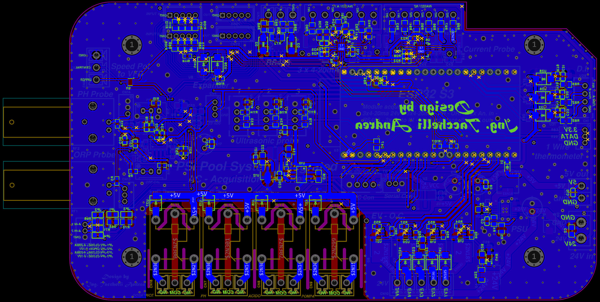
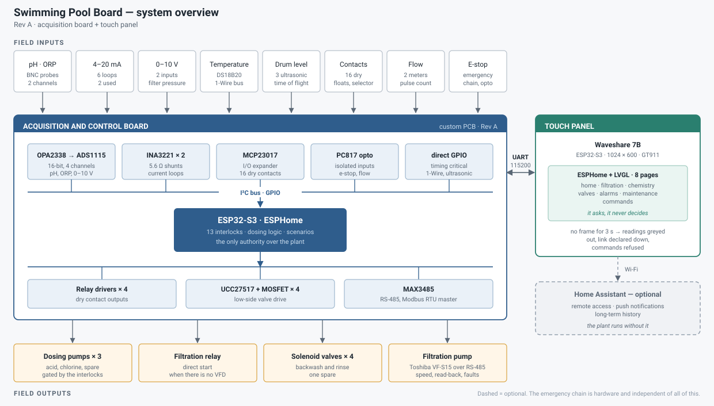

# Swimming Pool System Open

**An open-hardware brain for a swimming pool: it measures the water, doses the chemicals, runs the pump, and keeps everything safe.**

*[Italiano](README.it.md)* · Rev A · designed by Ing. Andrea Tacchelli

> **Status: proof of concept (POC).** A working prototype, shared to show the idea
> and collect feedback. It is not a finished product: hardware, firmware and
> documentation can still change. See [Status](#status).

## See it in action

*The 7" touch panel driving the system: plant synoptic, filtration pump and
scheduler, chemistry and dosing pulses, solenoid valves, alarms and the 13 dosing
interlocks, maintenance, direct commands and settings with the English/Italian
switch. Click the animation for the full-quality video (47 s).*

## In plain words

A pool needs its water kept in a narrow range: not too acid, not too basic, with
enough chlorine to stay clean and not so much that it irritates. Done by hand it
means test strips, buckets and guesswork. This board does it automatically.

- **It measures** pH, chlorine (ORP), water temperature, filter pressure, water
  flow and how much product is left in the tanks.
- **It acts**: it switches the dosing pumps, the filtration pump (even through a
  speed-controlled inverter) and the valves for waterfalls, jets and misters.
- **It protects**: before it adds any chemical it checks 13 conditions (pump
  running, water actually flowing, sensors agreeing, tank not empty, …). If one
  fails, it does not dose. If the hardware emergency button is pressed, everything
  stops, whatever the software is doing.
- **You control it** from a 7" touch screen on the cabinet, or from your phone or
  Home Assistant if you want. The pool keeps working without a network.

It was designed and built as a working prototype for a real pool. This repository is everything
needed to understand it, build it and improve it: schematic, PCB, parts list,
firmware and documentation.

## The hardware

| Top side | Bottom side |
|---|---|
|  |  |

A two-layer board built around an ESP32-S3. The board prints its own name,
"PSI Pool System Integrated, Acquisition Card Rev 0.A": that is this Rev A.

| | |
|---|---|
| **Measures** | pH and ORP (two probes each for cross-checking), pressure, temperature (DS18B20), flow (2 pulse meters), tank levels (ultrasonic + float switches), 6 × 4-20 mA industrial loops, 16 dry contacts |
| **Drives** | 4 relays (3 dosing pumps + filtration), 4 solenoid valves, an RS-485 Modbus link to a Toshiba VF-S15 inverter |
| **Thinks** | ESP32-S3 running ESPHome: 13 dosing permissives, pulsed manual dosing with a hard time limit, backwash sequence, safe state at power-up |
| **Shows** | Waveshare ESP32-S3 7" touch panel, 16 pages (home, filtration, scheduler, chemistry, valves, alarms, maintenance, commands, synoptic, trends, PIN-protected settings with Wi-Fi, parameters and pH/ORP calibration), English or Italian at the touch of a button, linked by a 3-wire serial cable |
| **Talks** | ESPHome native API (Home Assistant optional) |

Datasheet: [docs/datasheet.md](docs/datasheet.md) · [wiring (draft)](docs/wiring.md) · [use cases](docs/use-cases.md)

Full details: [pin map](docs/pin-map.md) · [inputs and outputs](docs/io-map.md) ·
[panel link protocol](docs/uart-protocol.md) · [hardware files](hardware/README.md)

## Status

**Proof of concept.** Rev A is a working prototype: the board, the touch panel
and the firmware run together, as shown in the [video](docs/media/display-demo.mp4).
It is not yet a finished, field-proven product: some hardware details are still to
be confirmed (see [docs/limitations.md](docs/limitations.md) and the
[wiring draft](docs/wiring.md)), and connectors, firmware and protocol may change
in the next revision.

It is a hobbyist-grade design shared for study and feedback, and is **not**
certified for any regulatory scheme. Read the
[safety notice](#safety-notice).

## Help us improve it

This project is public because we want your eyes on it. You do not need to be an
engineer to take part: pool owners, installers, makers and people who just find
it interesting are all welcome.

- **Look at the board** and tell us what you think: the layout, the choice of
  parts, anything that looks odd or could be simpler.
- **Tell us how you would use it**: what would you measure or control in your
  pool, garden or plant room? What is missing?
- **Spot errors** in the schematic, the parts list, the firmware or the
  documentation: open an **Issue**.
- **Share ideas and questions** in **Discussions**. The [next-revision
  ideas](#where-it-could-go-next-revision) are a good place to start: tell us
  which ones matter to you.
- **Build one** and tell us what happened. Photos are very welcome.
- **Want to talk business?** Manufacturing, resale, integration or a custom
  version: use the *Commercial* category in Discussions, or see
  [Contact](#contact).

See [CONTRIBUTING.md](CONTRIBUTING.md) for how to report things well.

## The touch panel

A 7" touch panel shows the plant and sends command requests; the control board
checks every request and can refuse it, returning the reason. Highlights:
filtration scheduler (daily, weekly, winter, shock, photovoltaic), two-point pH/ORP
calibration, plant parameters saved in flash, filter differential pressure with a
"backwash advised" notice, a synoptic diagram, Trends charts, and a language
switch (**Italian is always available** in Settings; English is only the default
at first boot).

[Watch the demo video](docs/media/display-demo.mp4) (also at the
[top of this page](#see-it-in-action)) · details in
[firmware/README.md](firmware/README.md) and the [panel protocol](docs/uart-protocol.md).

## Getting started

1. **Hardware**: order the PCB from the [Gerber files](hardware/fabrication/gerber.zip)
   and source the parts from [`hardware/bom.csv`](hardware/bom.csv).
2. **Firmware**: follow [`firmware/README.md`](firmware/README.md): copy
   `secrets.yaml.example`, tune the values at the top of `spb-control.yaml`,
   then `esphome run` both boards.
3. **First power-up**: go through the [bring-up checklist](docs/bring-up.md)
   before connecting any pump or valve.

## Assembly guide

*Coming soon.* A step-by-step guide to populating the board, wiring the cabinet
and commissioning it on a pool, with photos. A first [wiring draft](docs/wiring.md)
is already available.

## Where it could go: next revision

These are ideas for Rev B, not promises. Your feedback decides the order.

**Hardware**
- A **battery-backed clock**, so timers keep working without a network.
- **Analog outputs** (for example 0-10 V or 4-20 mA to drive other equipment).
- **A second RS-485 port**, for more devices on the bus.
- **Surge protection on every line** leaving the cabinet (sensor inputs, relays,
  valves), not only the 24 V input and the RS-485 pair.
- **Galvanic isolation** of the field inputs, and a cleaner reference for the pH
  probe when an electrolysis cell shares the water.
- Fewer plug-in modules: an **integrated ESP32-S3**, a simpler build and a lower
  cost.
- Review which connectors and relays are really needed, and make their labels
  unambiguous.

**Firmware and panel**
- Show **which alarm** fired, not only how many.
- Read **more temperature sensors** (for example the electrolysis cell).
- A double-buffered display for a smoother screen.
- Ready-made **Home Assistant dashboards** and notifications.
- Make the filtration schedule independent of the network clock (needs the battery-backed clock).

**Documentation**
- The assembly guide, and a wiring guide per connector.
- A commissioning guide for installers.

## Safety notice

This board switches dosing pumps for acid and chlorine, solenoid valves and a
filtration pump. A fault or a wiring or configuration error can release
chemicals or run equipment dry.

- The **emergency chain is hardware** and independent of the firmware. The
  thirteen dosing permissives in the firmware are a convenience, not the safety
  system. Build a proper hardware safety chain.
- All outputs start off, and manual dosing is always a time-limited pulse. These
  protections do not replace the emergency chain.
- Mains-voltage wiring must be done by a qualified person, in a suitable
  enclosure, with proper protection.
- The design comes with no warranty of any kind, and you use it at your own risk.

## Repository layout

| Folder | Content |
|---|---|
| [`hardware/`](hardware/README.md) | EasyEDA Pro project, Gerber files, schematic, assembly drawing, BOM, layout images, enclosure renders |
| [`firmware/`](firmware/README.md) | ESPHome configuration of both boards, and a Python simulator of the control board |
| [`docs/`](docs/) | pin map, I/O map, UART protocol, limitations, bring-up checklist |

Licence texts are in [`LICENSES/`](LICENSES/). Every document exists in English and Italian (`*.it.md`).

## Contact

Designed by **Ing. Andrea Tacchelli**. I design custom electronics and embedded
firmware (ESP32, ESPHome, industrial and home automation). If you like this work
and have a project, a product idea or a custom version in mind, get in touch:
[github.com/ingTacchelli](https://github.com/ingTacchelli) or a Discussion in
this repository.

## License

Open source, with one licence for each kind of material (summary in
[LICENSE](LICENSE)):

| Material | License |
|---|---|
| Hardware (`hardware/`) | [CERN-OHL-S v2](LICENSES/CERN-OHL-S-2.0.txt) — CERN Open Hardware Licence, strongly reciprocal |
| Firmware and simulator (`firmware/`) | [GPL-3.0-or-later](LICENSES/GPL-3.0-or-later.txt) |
| Documentation, images and video | [CC BY-SA 4.0](LICENSES/CC-BY-SA-4.0.txt) |

You may build, modify, install and sell it, also commercially, as long as you
keep the attribution and release your changes under the same licences.
